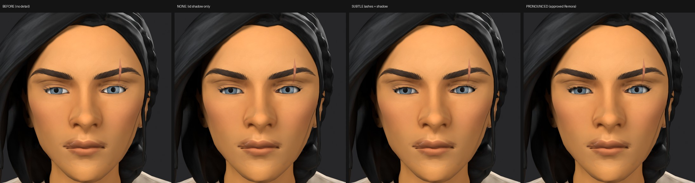

# Eye detail: lashes and lid shadow

*Type: how-to and reference. Approved on Remora 2026-11-06 (eyes73).*

A painted face with bare eyeballs reads as a doll: no lashes, no shadow where the
upper lid meets the eye, whites glaring at full brightness. `eye-detail` fixes that
on a finished character GLB in one CPU stage, in seconds:

- **Lashes:** upper and lower strand cards rooted on the lid's actual front margin,
  longest toward the outer corner, with a dark lash line at the roots. Optional, in
  presets: `pronounced`, `subtle`, or `none`.
- **Lid shadow (eye occlusion):** a thin see-through dark shell over each eyeball,
  strongest under the upper lid and at the corners.

Both follow the head's blink/expression morph targets and use its default weights.
The stage is **append-only**: the source binary is an exact prefix of the output and
every original node, mesh, accessor, material and image entry is verified unchanged.



## Choosing a preset

| `lashes` | Look | Use it for |
|---|---|---|
| `"pronounced"` | Defined lash line, visible upper strands | Remora's approved look; most women, stylized heroes |
| `"subtle"` | Short, sparse, light; reads as lid definition | Men, or anyone the full lashes look "made up" on |
| `"none"` | No lashes; lid shadow only | When lashes are already painted well, or not wanted |

`occlusion` is `"default"` or `"none"`. Override any value without forking a preset:
`"lashes": {"preset": "subtle", "upper": {"max_length_m": 0.002}}`.

Lashes are a taste call, not a fix. Review them on the actual consumer, and pick
per character.

## Run it

Standalone, on any finished GLB:

```powershell
rac run-stage eye-detail --source hero.glb --output hero-eyes.glb `
  --report hero-eyes-receipt.json --textures eye-recipe.json
```

As a step in a retained, replayable polish recipe (preferred; see
[POLISH_WORKFLOW.md](POLISH_WORKFLOW.md)):

```powershell
rac polish examples/polish/remora-eye-detail.json --output work/hero/eyes01
```

`examples/polish/remora-eye-detail.json` is the real approved recipe. Replaying it
reproduces the approved Remora GLB byte for byte (`93afce20…faf752a`).

## Minimal recipe

```json
{
  "schema": "reference-asset-compiler.eye-detail-recipe.v1",
  "source_sha256": "<sha256 of the source GLB; rac polish fills this in>",
  "head_mesh": "head",
  "eye_mesh": "eyes",
  "skin_material": "skin",
  "name_prefix": "Hero",
  "lashes": "subtle",
  "occlusion": "default"
}
```

| Field | Meaning |
|---|---|
| `head_mesh`, `eye_mesh` | glTF mesh names of the face and of the two eyeball helpers. Both must share one node transform. |
| `skin_material` | Material of the head primitive that carries the eyelid holes. |
| `name_prefix` | Names the added meshes `<prefix>_eye_lashes` / `<prefix>_eye_occlusion`. |
| `forward`, `up` | Mesh-local face direction and up; default glTF `+Z` and `+Y`. |
| `scale_to_local` | Metres-to-mesh-units factor; defaults to `1 / node scale`. Remora pins `1.0097113`. |
| `seed` | Lash strand layout seed (default 73). Same seed and recipe give the same bytes. |
| `margin_min_forward_m` | How far in front of the aperture edge a lash root must sit (default 1 mm; see below). |
| `max_aperture_offset` | Largest sideways offset allowed between an eyeball and its lid hole (default 12 mm). |

All lengths are metres. The full resolved settings, including every preset value,
are written into the receipt as `resolved_config`.

## What the head needs

- Eyelids modeled as **holes** in the head mesh (closed boundary loops, 10–80
  vertices) with a separate eyeball mesh behind each. The template heads used by
  `finish_template_head.py` / Remora qualify. A head with painted-shut eyes or
  eyeballs fused into the skin does not; the stage refuses rather than guessing.
- Head and eyeballs on the same node transform, not skinned. A rigged character
  needs a bone-bound route; run this before rigging, or extend it.
- Head and eye meshes with the same number of morph targets (zero is fine).

## How it finds the lid (and two traps)

1. It finds the closed boundary loop in front of each eyeball. Boundaries are
   detected **before** welding vertices: acquired template heads often carry a
   coincident duplicate lid layer, and welding first closes the hole.
2. Each lash root moves from the hole's edge to the **first skin vertex whose
   surface faces forward** (normal·forward ≥ `margin_facing`, at least
   `margin_min_forward_m` in front). On Remora the lid is a ~4 mm-deep tube:
   roots on the hole edge were hidden inside it, and "most forward vertex" jumped
   up to the lid crease. Both were rejected; see [DECISIONS.md](DECISIONS.md).
3. Strand textures must be thick enough to survive viewing distance. Real-width
   3 px strands on a 1024 px card were sub-pixel and invisible.

Each lash moves with the morph displacement of the lid vertex it is rooted on.
It translates with the lid; it does not curl on a blink.

## Review checklist

- Front, both quarters, profile, plus an eye closeup (the Remora recipe's
  `polish-review` step renders these on CPU).
- The actual consumer. In Framewright, check that the alpha-blended lashes and
  shell show no sorting holes or halos when you orbit.
- Blink and expression morphs: lashes stay on the lid, nothing pokes through.
- Inner corners: a lash line floating above the lid means the margin search
  picked too high a vertex; lower `margin_facing` or `margin_search_m`.

The receipt leaves `visual_acceptance` pending. The stage never approves an asset.

## Files

| Path | Role |
|---|---|
| `src/reference_asset_compiler/eye_detail.py` | Builder, presets, append-only check |
| `scripts/eye_detail.py` | `rac run-stage eye-detail` entry point |
| `examples/polish/remora-eye-detail.json` | Approved Remora recipe with review closeups |
| `tests/test_eye_detail.py` | Synthetic-head tests: morph following, presets, refusals |
| `docs/evidence/remora-eye-detail-20261106.json` | Hashes, replay proof and rejected attempts |

Known limits: no tearline or wet lower-lid line yet. In profile the lashes are
subtle. On Remora the inner end of the character-left upper lash line sits slightly
high.
