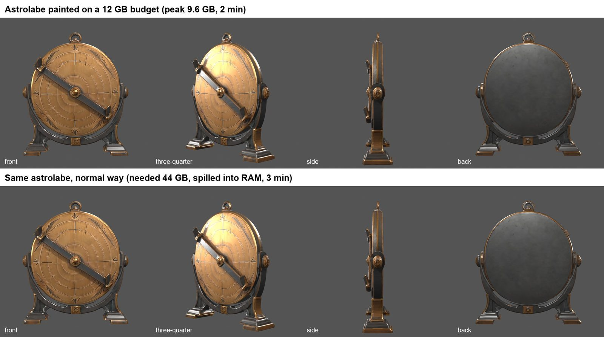

# v0.2.0 — RAC on a 12 GB GPU

The full image-to-textured-model pipeline now runs on a **12 GB graphics card**.
Until now, the AI stages wanted most of a 24 GB card. Geometry was gated at
18 GB free, and painting filled all 24 GB and then spilled into system RAM.
Every number below was measured on an RTX 4090 with a hard memory cap
standing in for a smaller card. Each before-and-after was also compared on
the model from front, three-quarter, side and back.

| Stage | Before | Now | Output |
| --- | --- | --- | --- |
| Geometry (Hunyuan3D-2, multiview or single image) | 18 GB / 12 GB floor | **8 GB** | Byte-identical mesh |
| Texture painting (Hunyuan3D-Paint 2.1, studio route, best quality) | 35–44 GB, spilling into RAM | **under 10 GB** | Visually identical (≈0.1% of pixels move, at UV edges) |
| Review renders | GPU only | **CPU optional** | Same views |

Painting is also **faster**, because it no longer spills into system memory.
At the best-quality setting (12 views × 768), a full character went from
119 s to 94 s, and the AR-02 astrolabe prop from 178 s to 125 s.

## What changed

**Geometry.** The image encoder leaves the GPU once it has read the pictures,
and the diffusion model leaves before the mesh is extracted. The result is the
same mesh, byte for byte, at a measured 5.2 GB peak instead of 7.9 GB. The
launcher's minimum free memory is now 8 GB, down from 18 GB. Requests can opt
out with `"release_stages": false`.

**Painting.** A profiler showed that paint's memory went into a few oversized
moments, not into the models themselves:
- decoding every generated view in one batch
- encoding all the normal and position maps in one batch
- the multi-view attention and feed-forward layers processing every view at once
- models that are used once and then sit idle

The studio paint route now runs each of those pieces one at a time. It parks
idle models in system RAM, tunes PyTorch's allocator against fragmentation,
and budgets PyTorch's memory pool to the VRAM that is actually free. Without
that budget, Windows lets an over-full card borrow system memory instead of
failing, and a run on a 24 GB card crawled for hours; with it, the same run
takes about two minutes and paints the same texture as the 12 GB run. On the way, it fixed an upstream trap: the diffusers pipeline
picks its device from an unordered set. Once the text encoder had left the
GPU, some runs drew their random noise on the CPU and produced a different
texture. The runner now pins the device to the GPU.

The minimum free memory for the studio route is now 10.5 GB, down from 21 GB.
To repaint exactly as before, for example to reproduce an older texture, pass
`-KeepStagesResident`. The default legacy route is unchanged. Its runner lives
in the studio tree, which RAC treats as read-only, and it still needs 21 GB.

**Measured, recorded, retained.** Every geometry and paint report now records
its peak VRAM. A run that fails, including on out-of-memory, also writes a
failure receipt with the same numbers, so floors come from evidence rather
than guesses. The calibration data is in `docs/evidence/`:
- `geometry-vram-calibration-20261030.json`
- `paint-vram-calibration-20261030.json`
- the on-model comparison sheets

**Review renders off the GPU.** Turnaround, close-up, material-ID, UV-debug and
landmark renders honour `RAC_RENDER_DEVICE=CPU`. Review no longer competes
with an inference job, and it works on machines without a usable GPU.

## Updating

Pull, reinstall with `python -m pip install -e ".[dev]"`, and run
`scripts\verify.ps1` and `scripts\workflow_doctor.ps1`. The geometry and studio
paint runners have new pinned hashes, recorded in `workflows/catalog.json`.
Use `run_hy3d21_texture.ps1 -RunnerKind studio` to get the 12 GB route.

Painting stays deterministic run to run on the same machine, but its maps are
not byte-identical to v0.1.x maps. Accepted textures keep their recorded
settings; repaint them with `-KeepStagesResident` if you need them
reproduced exactly. Nothing here changes an approval, and no asset was
re-judged.

Validated on an RTX 4090 (Windows, Python 3.11, CUDA 12.4) under a hard 10 GB
PyTorch allocator cap, standing in for a 12 GB card. Not yet run on a physical
12 GB card. Details: `docs/AI_STAGES_SETUP.md`, "Running geometry with less
VRAM" and "Painting with less VRAM".
