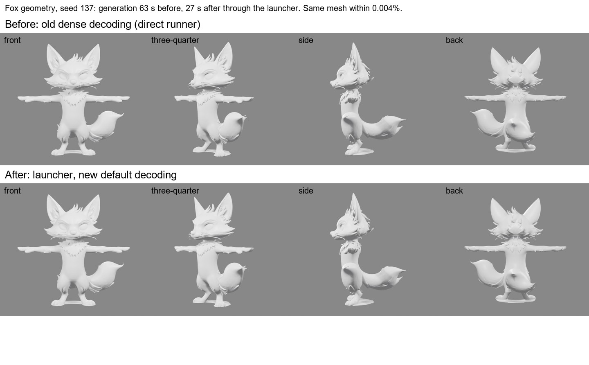

# v0.2.1 — Faster AI stages

Geometry generation is now about **3× faster** and best-quality painting
about **40 s faster**. Painted textures are byte-identical to before, and
meshes match the old ones to within 0.01% of the model's size. Each number
below was measured on an RTX 4090. Each geometry change was also compared on
the model from the front, three-quarter, side and back.

| Stage | Before | Now | Output |
| --- | --- | --- | --- |
| Geometry, three views (Hunyuan3D-2mv) | 63 s | **21 s** | Same mesh (max shift 0.008% of the diagonal) |
| Geometry, single picture (Hunyuan3D-2) | 55 s | **13 s** | Same mesh (max shift 0.008% of the diagonal) |
| Painting, studio route, 12 views × 768 (AR-02 astrolabe) | 146 s | **105 s** | Byte-identical maps |

These are generation times. A full launcher run adds model loading and
imports: about 65 s for three-view geometry and 126 s for painting.

## What changed

**Geometry: decode only near the surface.** Timing showed that two thirds of
the time went to checking every point of a 513³ grid to find the model's
surface. Hunyuan3D ships a coarse-to-fine decoder that only refines the cells
near the surface, but a bug broke it every time: it rounded its cell size to
zero. Both geometry runners now recompile that decoder from upstream's own
source with the one-line fix. If upstream's code ever changes under them, they
refuse to run. This is the default for new requests. `"volume_decoding":
"dense"` in a request brings back the old decoder, which you need to
reproduce an older mesh exactly. Each attempt records which decoder it used.

Upstream's faster FlashVDM decoder was tried and rejected. It is an
approximation that changes the shape and shrinks the whole mesh by 1.6%.

**Painting: fill both maps at once.** After baking, the studio paint route
fills gaps in the colour map and the metal-roughness map on the CPU. That used
to happen one map after the other, after both were baked. Each fill now starts
as soon as its map is baked, and the two run side by side. The maps are byte
for byte the same.

**Geometry launcher on Windows PowerShell 5.1.** Running
`scripts\run_hy3d_geometry.ps1` directly, as the playbook says, failed before
preflight on Windows PowerShell 5.1. That host leaves `$PSScriptRoot` empty in
a script's parameter defaults. `rac` was unaffected, because it passes
`-RepoRoot` explicitly. The launcher now resolves the path itself, and both
three-view and single-picture requests were run through it end to end.

## Updating

Pull, reinstall with `python -m pip install -e ".[dev]"`, and run
`scripts\verify.ps1` and `scripts\workflow_doctor.ps1`. The geometry runners
and the studio paint runner have new pinned hashes, recorded in
`workflows/catalog.json`.

Accepted meshes and textures are unaffected, and no asset was re-judged. The
diffusion steps are unchanged; they are the largest remaining cost (paint's
15 steps take about 60 s), and cutting them would change the output.

Timings: `docs/evidence/speed-calibration-20261031.json`. Details:
`docs/AI_STAGES_SETUP.md`, "Speed".
