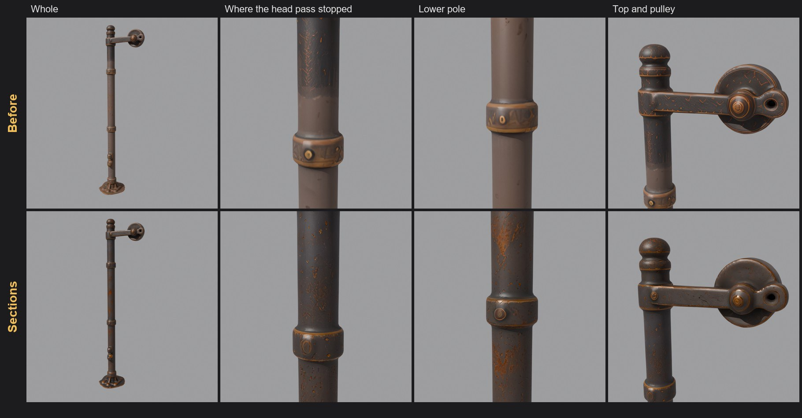
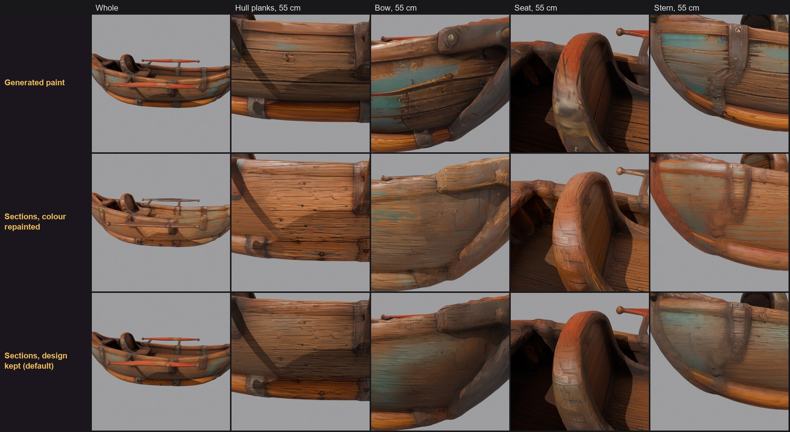
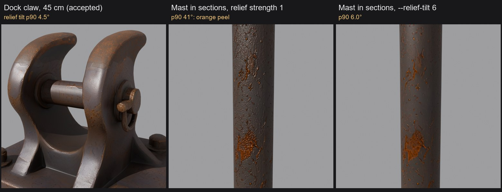
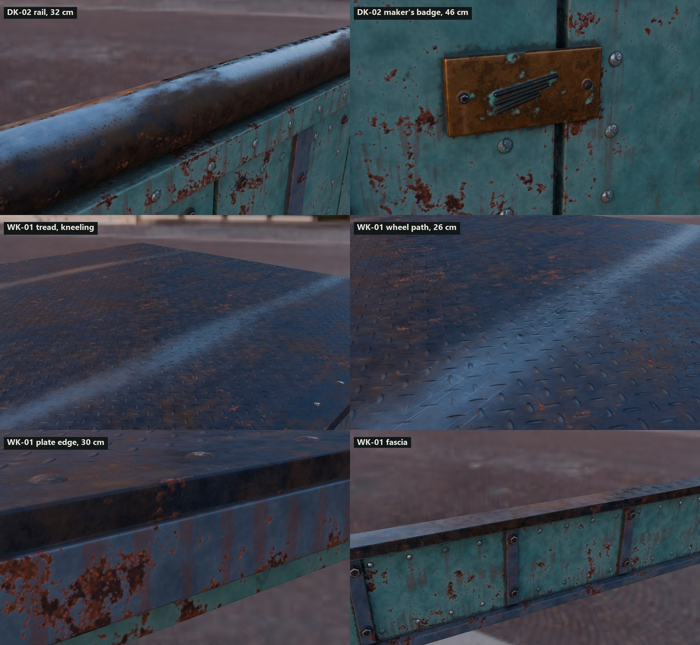
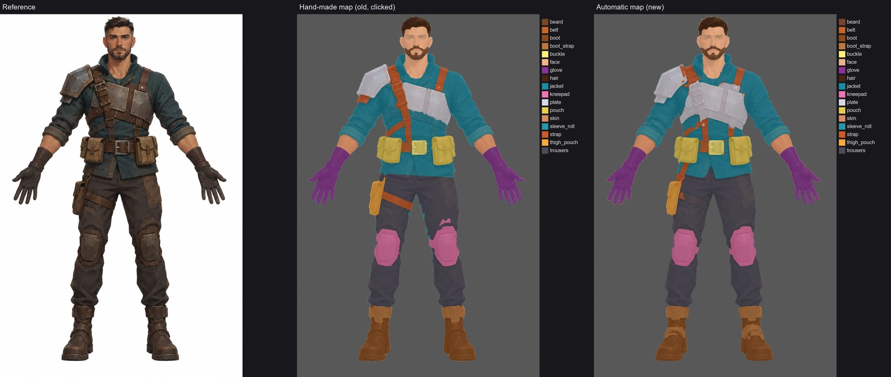

# v0.3.0 — Large models as sharp as small ones

Until now a 2-metre prop came out of RAC visibly softer than a 40-centimetre one. Up close in VR it was smeared and grainy where the small prop was crisp. This release closes that gap, and finishes hard surfaces from their own geometry.





The skiff above went from about 3 mm of surface per painted pixel to about 0.7 mm, in 45 sections and 109 minutes. The middle row shows why sections keep the first paint's colour by default: painted from crops, they turned the teal planks and red oars to plain wood.

## Paint in sections

**Why big models were soft.** The painter looks at a whole model through twelve views of 768 pixels, whatever its size. Measured on the pieces of one VR scene:

| Piece | Size | Surface per painted pixel |
| --- | --- | --- |
| Dock claw | 0.45 m | about 0.6 mm |
| Seat | 0.83 m | about 1.2 mm |
| Skiff | 2.2 m | about 3 mm |
| Hull | 15 m | about 2 cm |

The 4096 atlas and the upscaler after the painter can only stretch what the painter saw. A bigger atlas does not help.

**What the new stage does.** `paint-sections` cuts a painted model into sections about half a metre across.
- Each section is painted again on its own, from its own crop of the reference picture, and laid back over the model on the same UVs.
- Every face is painted at section scale, so no seam shows between a sharp part and a soft one.
- The first paint's colour is kept above 3 cm, and each section adds only its fine light and dark. A crop shows a section less of the design than the whole picture does, so a section left to choose its own colour loses it. `--keep-colour 0` lets sections repaint the colour, matched to each other where they overlap.
- A model under 1.2 m passes through untouched.

```powershell
rac run-stage paint-sections --source painted.glb --output sections.glb --report sections.json `
  --reference approved.png --views 12 --resolution 768 --atlas 4096
```

**What it costs.** One painter run per section: about 2.5 minutes each on an RTX 4090, with 21 GiB of GPU memory free. On the mast above, six sections took 11.6 minutes and brought the surface per painted pixel from 3.2 mm to 1.3 mm. For a small prop's detail on a 2–3 m piece, cut finer, as the skiff was: `--section 0.45 --overlap 0.2 --context 0.05 --max-sections 48`.

**What it replaces on props.** Hero models were given a second, close paint of their top 22%. That pass exists for faces, and on a prop it leaves a hard seam: crisp and the right colour above, soft and the wrong colour below. The mast above shows it. On a prop, paint in sections instead and keep the head pass for figures. [Framewright](https://github.com/raydeStar/framewright) does this for you.

## Relief calibrated to a steepness

`bake-detail` raises the paint's fine detail into a normal map. A fixed strength reads differently on every paint: on a busy paint, strength 1 tilted the normals 41° at the 90th percentile and the surface looked like orange peel. `--relief-tilt 6` picks the strength for each paint so that one texel in ten tilts 6°. The finished dock claw, which reads as cast iron, sits at 4.5°.



## Hard-surface finishing

Two stages finish ironwork, plate and machine parts from their own geometry:
- `bake-surface-maps` records, for every texel, where it is in metres, which way it faces and how open it is.
- `hard-surface-finish` paints from that record, on the CPU: primer, paint with thickness at the chip edge, rust that stands proud of the metal, grime, and short wear marks that follow hands, feet and wheels.

Every layer is a function of the geometry, so wear follows edges and nothing follows a UV seam. Built for a 17-piece modular berth, and checked by reproducing its published textures exactly.



See `docs/HARD_SURFACE_FINISH.md`.

## Automatic part map

A character's 2D part map no longer has to be clicked by hand. `scripts/auto_part_map.py` finds the parts with Grounding DINO and Segment Anything. It agrees with a hand-clicked map on 89% of pixels, and it labelled three looks it was never tuned on.



## Fixes

- **No more plastic sheen.** Hunyuan3D-Paint writes `KHR_materials_specular` at twice the default, which Blender reads as Specular Tint 2. Every painted model looked like plastic. `browser-payload` now resets those defaults and records that it did.
- **Seam-cut meshes keep their surface.** Some generators, Pixal3D among them, write a mesh cut along every texture seam. The voxel reductions counted each island as a loose piece and deleted 11% of a skiff's hull as debris. They now join seam copies first, as `reduce-mesh` already did.
- **`--context` reaches `paint-sections`.** The finer cut above can now be run through `rac run-stage`.
- **Long section passes finish, and a stopped one resumes.** `rac run-stage` gave every stage an hour, and the finer cut stopped at section 20 of 32. `paint-sections` now gets four hours, and the stage listing reports each stage's limit. `--reuse-sections <attempt>` takes the sections an earlier attempt already painted from the same mesh, crop and settings, and paints only the rest. A stage that runs out of time now stops everything it started. The first stopped pass left its painter running on the GPU.

## Also in this release

- **Game review road.** `scripts/run_game_review.ps1` takes a polished character GLB to a playable review in the game: rig, binding, retargeted animation and in-game close-ups. It is for review, never production.
- **Surface finishing family.** Material sweep, reference patch, payload prune, the polish workflow and eye detail.
- **Character rebuild options.** A frozen head finish, a stop after assembly, head-template and mesh-hair options.
- **Rigid parts.** A robot of separate parts can be bound one part to one bone (`rigid_part_binding`).
- **Animation.** Retuned climb and traversal clips.
- **Records.** Five weeks of logs and lessons, landed in date order. The newest covers reducing a Pixal3D mesh to a game budget with Pixal's own simplifier, since neither RAC reduction keeps its hard edges.

## Updating

Pull, reinstall with `python -m pip install -e ".[dev]"`, and run `scripts\verify.ps1` and `scripts\workflow_doctor.ps1`. `rac run-stage --list` shows the new stages: `paint-sections`, `bake-surface-maps` and `hard-surface-finish`. The `paint-sections` entry now also says how long a section takes.

Accepted assets are unchanged and nothing was re-judged. Painting in sections is an extra pass you choose. A model already painted keeps its paint until you run it.
