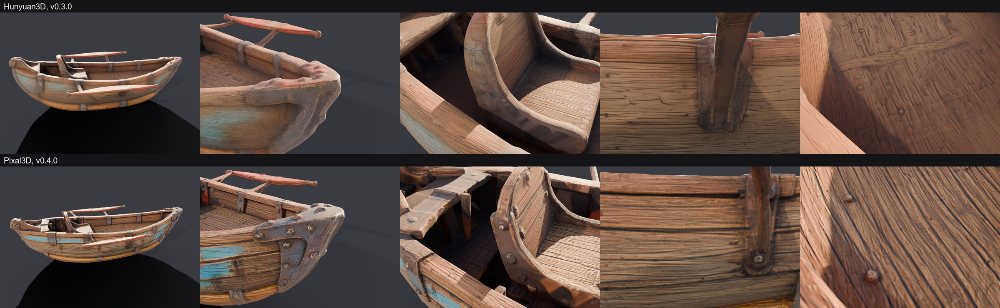
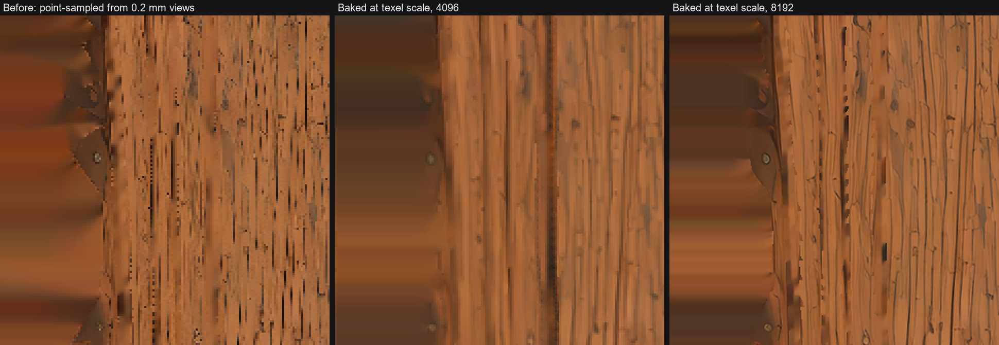
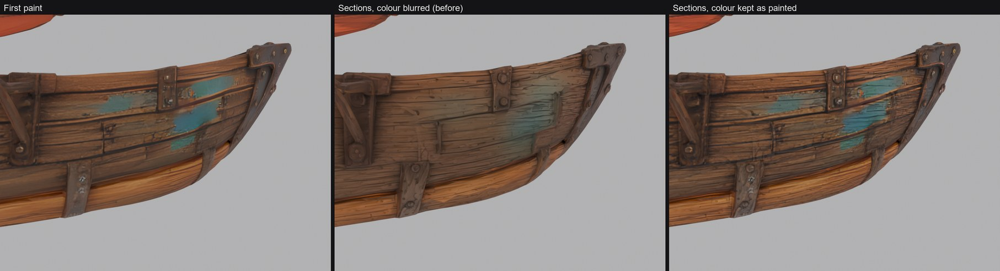

# v0.4.0 — Props that hold up at arm's length

v0.3.0 made a 2-metre prop as sharp as a small one from a step back. Up close in VR the skiff still looked grainy, smeared in places and wrongly coloured in others. This release finds each cause and fixes it, and adds a second geometry route, Pixal3D, whose hard edges survive all the way to the game mesh.

## Pixal3D, end to end

[Pixal3D](https://github.com/TencentARC/Pixal3D) builds rivets, straps and plank seams as real geometry, where Hunyuan3D-2 rounds them into blobs. Getting that to a game mesh took three pieces, all new:

- **`run_pixal3d.py --extra-targets 100000`** also writes the game mesh, from the same generation, using Pixal's own simplifier. Neither of RAC's reductions keeps Pixal's hard edges: the voxel rebuild melts them, and edge collapse wrinkles them even at 200k triangles. Pixal's simplifier gave the skiff 98k clean triangles.
- **`scripts/blender/level_pair.py`** levels the dense mesh and the game mesh with one transform, at the real size. Pixal keeps the picture's camera tilt, and two separately levelled files would not line up.
- **`bake-shape`** is a new stage. It bakes the dense mesh's million triangles into the game mesh's normal map, under the relief raised from the paint.

The playbook has the whole route as commands, with times: "A hard-surface prop from Pixal3D, end to end".

## No more grain: bake at texel scale, on an 8192 sheet

The section paint was grainy before anything else touched it. The painter gives each texel one sample of each view, and it bakes from views upscaled to 3072 pixels. Upstream's resize reaches only two of the twelve views. On a half-metre section that is 0.2 mm a pixel against 1.75 mm texels, so each texel took one pore at random, and wood grain broke into dashes and specks.

- **Texel-scale bake.** Each section's views are shrunk to about a texel a pixel, with an antialiasing filter, before they are baked. `paint-sections` sizes this from the model's own texel density (`--bake-scale 1`, the default). The speckle measure halved, and the grain runs as lines again.
- **8192 sheet.** `--atlas 8192` on `texture` and `paint-sections` paints and keeps an 8192 sheet: about 0.9 mm a texel on the skiff, at the same painting time per section. The browser copy fits Framewright's limits as 8192 JPEG at quality 92: 51 MB, 47 MB of it texture.
- **Smooth blends.** Sections cross-fade through weights taken from each face's corners. A weight per face had left hard triangles where two sections met.

## The design stays the first paint's

Sections used to keep the first paint's colour only above 3 cm, by blurring it on the flat texture sheet. Near a UV island's edge, that blur reached into unrelated neighbouring islands. The skiff's teal chips smeared, its fin lost its cream band, and its stern went grey in hard-edged wedges. Now the first paint's colour is kept exactly as painted. Sections add only their light and dark finer than `--keep-colour` (now 1 cm), as a brightness ratio that cannot move colour.

A pass that only changes how sections are laid reuses every painted section (`--reuse-sections`), so trying a setting costs minutes, not hours.

## Also

- `paint-sections` gets four hours by default, and a stopped pass resumes with `--reuse-sections`. A section is reused only when the painter's own record shows the same mesh, crop, settings and bake size.
- The voxel reductions weld seam-split vertices before discarding small pieces. Pixal's file lost 11% of its hull to that cleanup.
- Lessons in `docs/DECISIONS.md`: why reduce a Pixal mesh with Pixal's own simplifier, and what makes section paint grainy or patchy.

## Known faults, next

- The painter can project one part's colour onto another behind it. On the skiff, the fin's red landed on an iron bracket.
- Faces no view sees are filled in flat.

Both come from painting a whole model at once. Painting by parts is the next step, and so is making every stage fit a 12 GB card, with a reduced route for 6 GB.

## Updating

Pull, reinstall with `python -m pip install -e ".[dev]"`, and run `scripts\verify.ps1`. Stages are unchanged except as above, and accepted assets are not re-judged. A model painted before this release keeps its paint until it is painted again. The studio painter's pinned hash changed, so a launcher from v0.3.0 will refuse the new runner.
