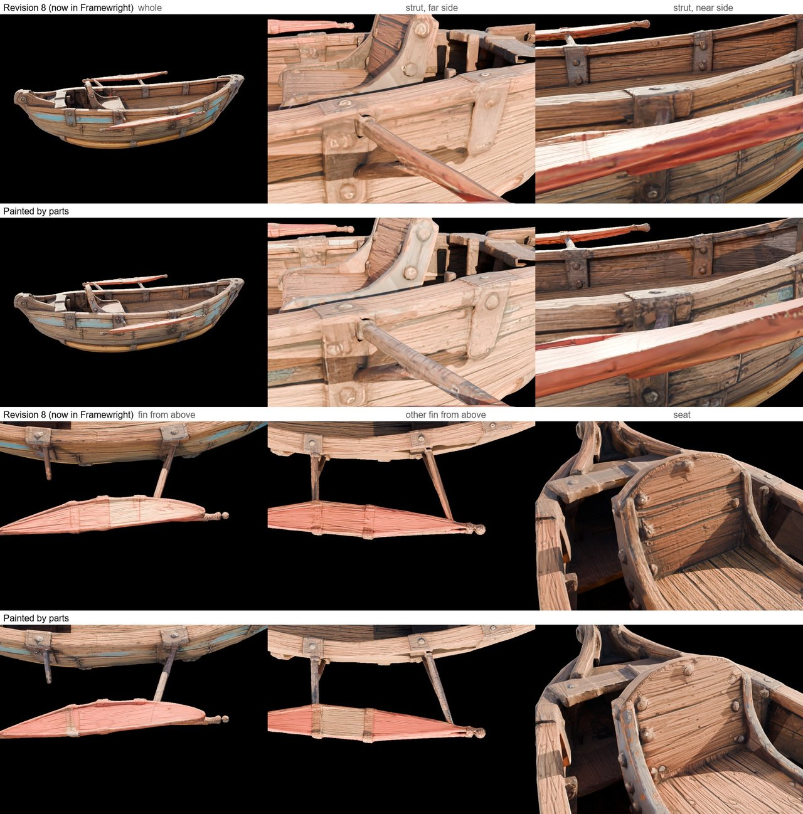
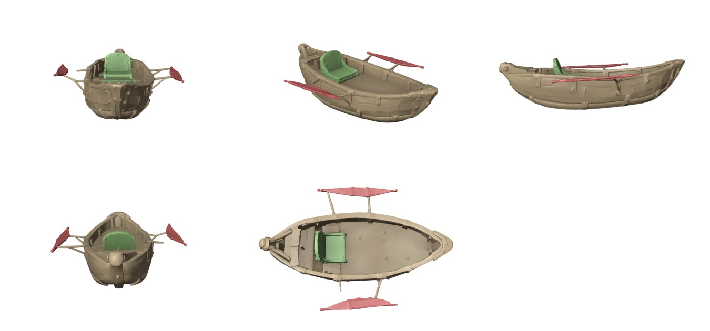
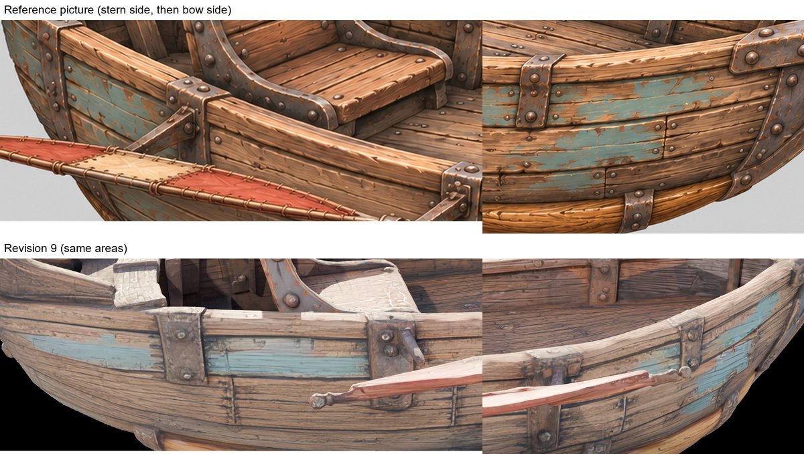

# v0.5.0 — Paint by parts

v0.4.0 left the skiff with faults no compositing could remove. The painter saw parts overlap in its views and carried one part's colour onto another: the fin's red landed on the strut that holds it, a fin lost its cream band, and the seat's iron edging was painted as wood. This release paints a model part by part, each from its own picture, and lays the parts back with hard edges where they meet. On the Frastown skiff the owner called the result "perfect".

## Two new stages

- **`rac run-stage label-parts`** finds a painted model's parts, face by face, and the same parts in its reference picture.
  - It renders 24 views of the model and records the face under every pixel.
  - Grounding DINO and Segment Anything (both Apache-2.0) label each render and the reference from a vocabulary of parts.
  - It votes the labels onto the faces.
  - It renders review views in part colours. Look at these before painting: the labelling is a candidate.
  - On the skiff it takes under a minute.
- **`rac run-stage paint-parts`** paints each part alone.
  - Each piece is painted from the reference with every other part made transparent, and laid on exactly its own faces' texels.
  - It takes about 3.5 minutes a piece. The skiff is three pieces: hull, seat and fins.
  - `paint-sections` goes over the result as before. Its sections depend only on the mesh and their crop, so all 32 of the skiff's sections were reused.

A vocabulary is a short JSON file. `profiles/segmentation/skiff-parts.json` names a base part that every unclaimed face belongs to, and the parts to find, each with the phrases the detector is asked. For another model, copy it and name that model's parts. The playbook's prop recipe ("A hard-surface prop from Pixal3D, end to end") now includes both stages.

`label-parts` runs the detector in a Python with torch. ComfyUI's portable Python works. Name it, and the two model files, with `--torch-python`, `--detector` and `--sam`, or with `RAC_TORCH_PYTHON`, `RAC_GROUNDING_DINO` and `RAC_SAM_CHECKPOINT`. `rac run-stage --list` says what is missing.

## What the skiff taught

Each rule was measured on the skiff (`docs/DECISIONS.md` has the numbers):

- **Judge a detector's box against the model, not the picture.** A small part's phrase also matches the whole boat, which fills only a fifth of a render.
- **Let parts compete.** Where two parts' boxes cover one region, the better score keeps it.
- **Fill the holes in a part's picture.** Where the seat stood on the floor, the hull's picture is filled from the surrounding colours. A hole left in a fin's mask came back as white marks.
- **Paint thin, repeated parts together.** Painted one at a time, one fin came back pale and the other marked. Painted together, both came back red, cream and red.
- **Keep the first paint's roughness and metal.** Isolated, the fins came back glossy and the sun washed them out.

## Known fault

The hull's teal paint is solid bands where the picture has chipped paint over wood. The hull is 2.2 m, too large to paint chips in one piece, and the sections add only light and dark.

## Next

- Making every stage faster.
- Fitting every stage on a 12 GB card, with a reduced route for 6 GB.

## Updating

Pull, reinstall with `python -m pip install -e ".[dev]"`, and run `scripts\verify.ps1`. No existing stage changed, and accepted assets are not re-judged.
